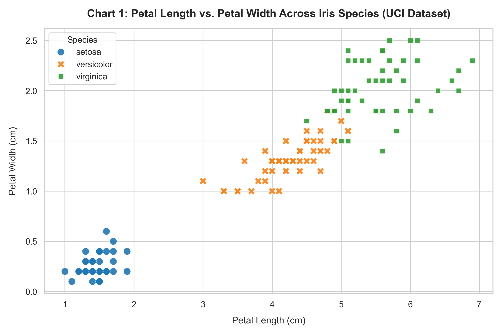
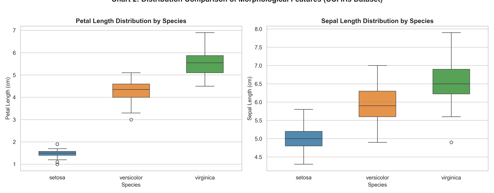

# First Python Program on a Public Dataset: Iris Flower Analysis

[](https://www.python.org/)
[](https://jupyter.org/)
[](https://pandas.pydata.org/)
[](https://numpy.org/)
[](https://matplotlib.org/)
[](https://seaborn.pydata.org/)

An introductory exploratory data analysis (EDA) and data visualization program written in Python, analyzing the classic **Iris Flower Dataset** sourced from the **UCI Machine Learning Repository**.

---

## 📌 Dataset Source & Attribution

- **Dataset Name:** Iris Species Dataset
- **Repository:** [UCI Machine Learning Repository](https://archive.ics.uci.edu/dataset/53/iris)
- **Direct Raw Data URL:** [https://archive.ics.uci.edu/ml/machine-learning-databases/iris/iris.data](https://archive.ics.uci.edu/ml/machine-learning-databases/iris/iris.data)
- **Creator / Donator:** Ronald A. Fisher (1936), donated by Michael Marshall (1988)
- **Dataset Attributes:**
  - `sepal_length`: Sepal length in centimeters (continuous numeric)
  - `sepal_width`: Sepal width in centimeters (continuous numeric)
  - `petal_length`: Petal length in centimeters (continuous numeric)
  - `petal_width`: Petal width in centimeters (continuous numeric)
  - `species`: Flower species (`setosa`, `versicolor`, `virginica`)
- **Total Records:** 150 instances (50 samples per species, perfectly balanced, 0 missing values)

---

## 📓 Interactive Notebook (Outputs Visible)

The full Jupyter notebook with all code cells, printed outputs, summary tables, and rendered charts is available directly at:
👉 **[View Notebook: `first_python_program.ipynb`](first_python_program.ipynb)**

---

## 🗂️ Project Structure

```text
Write-first-Python-program/
├── .gitignore                          # Git ignore rules for Python & Jupyter
├── README.md                           # Project documentation and summary
├── requirements.txt                    # Project dependencies
├── chart1_petal_dimensions.png         # Exported Chart 1 (Scatter plot)
├── chart2_feature_distributions.png    # Exported Chart 2 (Box plots)
├── data/
│   └── iris.csv                        # Local copy of UCI Iris dataset
└── first_python_program.ipynb          # Executed Jupyter notebook with outputs visible
```

---

## 🚀 Getting Started

### 1. Clone the Repository
```bash
git clone https://github.com/godwintharun3-source/Write-first-Python-program.git
cd Write-first-Python-program
```

### 2. Set Up Virtual Environment & Install Dependencies
```bash
python3 -m venv venv
source venv/bin/activate    # On Windows: venv\Scripts\activate
pip install -r requirements.txt
```

### 3. Launch the Jupyter Notebook
```bash
jupyter notebook first_python_program.ipynb
```

---

## 💻 Code Walkthrough & Output Summary

### 1. Loading the Dataset with Pandas
```python
import pandas as pd
import numpy as np
import matplotlib.pyplot as plt
import seaborn as sns

data_path = "data/iris.csv"
df = pd.read_csv(data_path)
df.head()
```

**Output (First 5 Rows):**
| sepal_length | sepal_width | petal_length | petal_width | species |
|:------------:|:-----------:|:------------:|:-----------:|:-------:|
| 5.1 | 3.5 | 1.4 | 0.2 | setosa |
| 4.9 | 3.0 | 1.4 | 0.2 | setosa |
| 4.7 | 3.2 | 1.3 | 0.2 | setosa |
| 4.6 | 3.1 | 1.5 | 0.2 | setosa |
| 5.0 | 3.6 | 1.4 | 0.2 | setosa |

---

### 2. Statistical Analysis & Group Averages
```python
# Grouped averages by species (in cm)
species_stats = df.groupby("species").agg(
    mean_sepal_length=("sepal_length", np.mean),
    mean_sepal_width=("sepal_width", np.mean),
    mean_petal_length=("petal_length", np.mean),
    mean_petal_width=("petal_width", np.mean)
)
print(species_stats.round(2))
```

**Output (Species Averages in cm):**
| species | mean_sepal_length | mean_sepal_width | mean_petal_length | mean_petal_width |
|:-------:|:-----------------:|:----------------:|:-----------------:|:----------------:|
| **setosa** | 5.01 | 3.42 | 1.46 | 0.24 |
| **versicolor** | 5.94 | 2.77 | 4.26 | 1.33 |
| **virginica** | 6.59 | 2.97 | 5.55 | 2.03 |

**Correlation Matrix:**
| Feature | sepal_length | sepal_width | petal_length | petal_width |
|:-------:|:------------:|:-----------:|:------------:|:-----------:|
| **sepal_length** | 1.000 | -0.109 | 0.872 | 0.818 |
| **sepal_width** | -0.109 | 1.000 | -0.421 | -0.357 |
| **petal_length** | 0.872 | -0.421 | 1.000 | **0.963** |
| **petal_width** | 0.818 | -0.357 | **0.963** | 1.000 |

---

## 📊 Visualizations

### Chart 1: Petal Length vs. Petal Width Across Iris Species


### Chart 2: Feature Distribution Comparison (Box Plots)


---

## 🔍 Key Findings in Plain Words

1. **Iris Setosa is Completely Distinct:**
   - *Iris setosa* specimens have significantly smaller petals (averaging **1.46 cm long** and **0.24 cm wide**) compared to the other two species.
   - On the scatter plot, Setosa points form an isolated cluster at the bottom-left with zero overlap, meaning a single rule (`petal_length < 2.5 cm`) classifies Setosa with 100% accuracy.

2. **Strong Linear Correlation Between Petal Dimensions ($r = 0.963$):**
   - Petal length and petal width exhibit a very high positive linear correlation. Flowers with longer petals consistently possess proportionally wider petals.

3. **Separation of Versicolor and Virginica:**
   - While *Iris versicolor* and *Iris virginica* have slight overlap in sepal dimensions, petal measurements clearly distinguish them:
     - *Versicolor* petals average **4.26 cm** in length and **1.33 cm** in width.
     - *Virginica* petals average **5.55 cm** in length and **2.03 cm** in width.
   - Petal size is the most reliable morphological discriminator between the species.

4. **Data Cleanliness & Balance:**
   - The dataset contains exactly 50 samples for each class (150 total records) with **no missing or null values**, making it an ideal foundational dataset for exploratory data analysis.

---

## 👤 Author
- **Name:** Tharun Godwin C
- **GitHub:** [@godwintharun3-source](https://github.com/godwintharun3-source)
- **Repository:** [Write-first-Python-program](https://github.com/godwintharun3-source/Write-first-Python-program)
